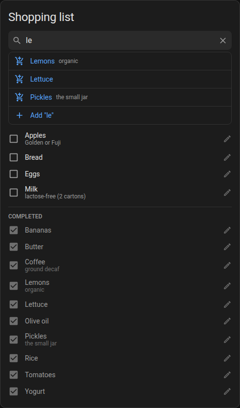

# Shopping List Card

A custom card for a quick shopping list, built on top of Home Assistant's [To-do list](https://www.home-assistant.io/integrations/todo/) entities.



## Configuration

Any to-do list entity works, such as the one created by the [Shopping List](https://www.home-assistant.io/integrations/shopping_list/) integration or a [Local To-do](https://www.home-assistant.io/integrations/local_todo/) list.

To add the card into your panel, add a custom YAML card of type `custom:shopping-list-card`.

Example configuration:

```yml
type: custom:shopping-list-card
entity: todo.shopping_list
```

A comprehensive list of available options is provided below:

| Field          | Required | Description |
|----------------|----------|-------------|
| entity         | Yes      | The to-do list entity to show. |
| title          | No       | Card title override. |
| show_title     | No       | Set to `false` to hide the title, e.g. in a panel view. Defaults to `true`. |

## Usage

The card always shows every item in the list, sorted alphabetically: first the pending ones,
and below them the completed ones. Click any item to mark it as completed, or as pending again.
Item descriptions, if any, are shown in smaller text below their name (e.g. the store to buy it from).

The pencil icon next to each item opens a dialog to rename it, change its description, or delete it.
The description field only shows up if the to-do list supports descriptions.

The idea is to keep every product you usually buy in the list, marking them as pending when you run out of them.
To do that, start typing in the search box: completed items matching the text are shown right below it, so a single
click marks them as pending again. If the product isn't on the list yet, the last option adds it as a new item.
Searching ignores case and accents, so typing "azucar" finds "Azúcar".

Pressing Enter picks the first option (the first matching item, or adding a new one if nothing matches),
and Escape clears the search box.

Click the "Completed" header to fold the completed items away (or show them again): they can still be found through
the search box. This choice is remembered on each device, so you can keep them folded on your phone but visible on a big screen.

The search box stays visible at the top while scrolling down a long list.
On very wide cards, such as the only card in a panel view, the content keeps a readable width and is centered.

Changes are synced live, so updates made from other devices or from Home Assistant's own to-do panel show up immediately.
